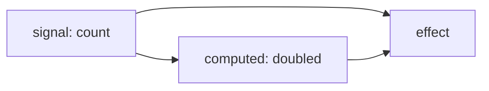

# Mora

[](https://www.npmjs.com/package/@oscarpalmer/mora) [](https://github.com/oscarpalmer/mora/actions/workflows/test.yml)

Signals and stuff…

Mora is a small library for reactive state: signals hold values, computeds derive values from them, and effects run when the values they read change. Dependencies are tracked automatically, from what your code reads. It also has reactive arrays and stores, readonly views, subscriptions, and batching.

Mora is framework-agnostic and has no rendering model. If you want signals wired into a UI framework's components, use a library that ships those bindings instead.

## Core concepts

| Term                | Is                                                                                 | Is not                                                         |
| ------------------- | ---------------------------------------------------------------------------------- | -------------------------------------------------------------- |
| __Signal__          | A container for one value; reading it in a computed or effect creates a dependency | A stream — it holds only the current value                     |
| __Computed__        | A value derived from signals, recomputed when read after a dependency changed      | Eager — an unread computed costs nothing                       |
| __Effect__          | A callback that runs now, and again when anything it read changes                  | A computed — it produces no value                              |
| __Array / store__   | An array or plain object that is reactive per index or key                         | Deeply reactive — see [`notify()`](#notify-for-nested-changes) |
| __Readonly signal__ | A read-only view of a signal, array, or store                                      | A copy — it follows its source                                 |
| __Subscription__    | A callback that receives a signal's new value after each change                    | Tracked — it creates no dependencies                           |
| __Batch__           | A span in which effects and subscribers wait, so several writes cause one update   | A transaction — reads see new values immediately               |
| __Scope__           | A group of effects and computeds disposed of together                              | Required — top-level effects work without one                  |

## Quick start

```typescript
import {computed, effect, signal} from '@oscarpalmer/mora';

const count = signal(1);
const doubled = computed(() => count.get() * 2);

effect(() => {
  console.log(`${count.get()} × 2 = ${doubled.get()}`);
});
// Logs: 1 × 2 = 2

count.set(2);
// Logs: 2 × 2 = 4
```

The effect never lists its dependencies: reading `count` and `doubled` is enough.

## Installation

```sh
npm install @oscarpalmer/mora
```

Mora is an ES module with TypeScript declarations, and runs anywhere [`Proxy`](https://developer.mozilla.org/en-US/docs/Web/JavaScript/Reference/Global_Objects/Proxy) is supported, such as current browsers and Node.js.

## How Mora works

### Tracking and updates

An effect or computed depends on every signal it reads with `get()` during its last run. Dependencies are rebuilt on every run, so a branch that's no longer taken stops being one. Read with `peek()` to avoid creating a dependency.



When `count` (from the [quick start](#quick-start)) changes:

1. Its dependents are marked, and nothing is recomputed yet.
2. Each marked effect brings its computeds up to date first, recomputing each at most once.
3. If no dependency ended up with a different value, the effect doesn't run.

So a computed that recomputes to an equal value (by [`Object.is`](https://developer.mozilla.org/en-US/docs/Web/JavaScript/Reference/Global_Objects/Object/is), by default) stops the update there.

### Signals

```typescript
import {signal} from '@oscarpalmer/mora';

const name = signal('Hermaeus');

name.get();  // 'Hermaeus' (tracked)
name.peek(); // 'Hermaeus' (not tracked)

name.set('Mora');
name.update(current => `${current}!`); // 'Mora!'
```

`signal()` and `set()` also accept:

- __A function__, whose return value is used. If it throws, the value doesn't change.
- __A promise__, whose value is used once it fulfills. Rejected promises, and promises replaced by a newer value before settling, are ignored.

Setting an equal value does nothing. To change what counts as equal, pass an `equal` option:

```typescript
const point = signal({x: 1, y: 2}, {
  equal: (first, second) => first.x === second.x && first.y === second.y,
});

point.set({x: 1, y: 2}); // Equal, so nothing happens
```

### Computeds

```typescript
import {computed, signal} from '@oscarpalmer/mora';

const firstName = signal('Hermaeus');
const lastName = signal('Mora');

const fullName = computed(() => `${firstName.get()} ${lastName.get()}`);

fullName.get(); // 'Hermaeus Mora'
```

A computed is lazy: its callback first runs when the computed is read, and then only when it's read after a dependency changed. Every read returns an up-to-date value, even inside a [batch](#batching). If the callback throws, the previous value is kept.

The callback can return a promise. The value is `undefined` until the first one fulfills, and rejected promises are ignored. Only signals read before the first `await` are tracked:

```typescript
const id = signal(1);

const user = computed(async () => {
  const response = await fetch(`/users/${id.get()}`); // Tracked: read before the `await`

  return response.json();
});
```

### Effects

```typescript
import {effect, signal} from '@oscarpalmer/mora';

const theme = signal('dark');

const fx = effect(() => {
  document.body.dataset.theme = theme.get();
});

theme.set('light'); // Runs again

fx.stop();
theme.set('dark'); // Doesn't run
```

If the callback throws on its first run, `effect()` throws.

> [!NOTE]
> Handle errors inside effects. When an effect throws on a later run, a `set()` that triggered it ignores the error, while an assignment through an array's or store's `get()` throws it.

Effects and computeds created inside an effect or computed belong to it, and are stopped when it runs again or stops. That keeps re-running effects from piling up copies of what they create:

```typescript
const selected = signal(1);
const details = signal('…');

effect(() => {
  const id = selected.get();

  effect(() => {
    console.log(id, details.get()); // Stopped and recreated when `selected` changes
  });
});
```

To make something outlive its creator, use a [scope](#scopes).

### Subscriptions

A subscriber receives the new value after each change, and doesn't track what it reads:

```typescript
import {signal} from '@oscarpalmer/mora';

const count = signal(1);

const subscription = count.subscribe(value => {
  console.log(value);
});
// Logs: 1 (called immediately)

count.set(2); // Logs: 2

subscription.unsubscribe();
```

Subscribing the same function again returns the existing subscription. Pass `true` as the second argument to receive shallow copies of arrays and objects.

### Batching

```typescript
import {effect, signal, startBatch, stopBatch} from '@oscarpalmer/mora';

const width = signal(1);
const height = signal(1);

effect(() => {
  console.log(width.get() * height.get());
});
// Logs: 1

startBatch();

width.set(2);
height.set(3);

stopBatch();
// Logs: 6 (once)
```

Effects and subscribers wait until the outermost batch stops; reads see new values immediately.

> [!IMPORTANT]
> Match every `startBatch()` with a `stopBatch()`, using `try`/`finally` if the code in between can throw. Until then, every effect and subscriber is held back.

### Reactive arrays

```typescript
import {array, effect} from '@oscarpalmer/mora';

const items = array(['a', 'b']);

effect(() => {
  console.log(items.get(0)); // Runs again only when the first item changes
});

items.push('c');   // Doesn't run
items.set(0, 'z'); // Runs
```

`get()` returns the array itself, so assigning to an index or `length`, or calling a mutating method on it (`push`, `sort`, `splice`, …), notifies dependents too.

`filter()`, `map()`, and `select()` return computeds of the array:

```typescript
const numbers = array([1, 2, 3, 4]);

const even = numbers.filter(value => value % 2 === 0);
const evenDoubled = numbers.select(value => value % 2 === 0, value => value * 2);

numbers.push(5, 6);

even.get();        // [2, 4, 6]
evenDoubled.get(); // [4, 8, 12]
```

Created outside an effect or computed, they're deactivated along with the array.

### Reactive stores

```typescript
import {effect, store} from '@oscarpalmer/mora';

const settings = store({theme: 'dark', volume: 5});

effect(() => {
  console.log(settings.get('theme')); // Runs again only when `theme` changes
});

settings.set('volume', 7);      // Doesn't run
settings.get().theme = 'light'; // Runs
```

`set(object)` replaces the contents, removing missing keys. Deleting a key through `get()` notifies dependents too.

#### `notify()` for nested changes

Arrays and stores don't notice changes inside nested objects. Call `notify()` afterwards to notify every dependent anyway:

```typescript
const todos = array([{done: false, title: 'Read'}]);

todos.peek(0)!.done = true; // Not noticed
todos.notify();
```

### Readonly signals

```typescript
const count = signal(1);

const readonly = count.asReadonly();
const frozen = count.asReadonly(true); // Returns arrays and objects as frozen copies
```

A readonly can be read and subscribed to, but not written. Each signal, array, or store returns the same readonly for each kind until it's deactivated. Deactivating a readonly keeps a snapshot of its value and ends the subscriptions made through it, without affecting its source.

### Lifetime and cleanup

- `effect.stop()` stops an effect.
- `deactivate()` freezes a signal, computed, array, store, or readonly at its current value: writes are ignored, and dependents and subscribers stop being notified. It also deactivates the readonlies of a source, and the computeds an array or store created.
- Both are safe to call more than once; `active` tells you which state it's in.

#### Scopes

`scope()` collects the effects and computeds created in its callback, and returns a function that disposes of all of them, even if they were created inside another effect:

```typescript
import {effect, scope} from '@oscarpalmer/mora';

const dispose = scope(() => {
  effect(() => {/* … */});
  effect(() => {/* … */});
});

dispose(); // Stops both effects
```

### Type guards

Each guard checks whether a value is of a given kind, and narrows its type accordingly.

| Guard                     | Returns `true` for                                 |
| ------------------------- | -------------------------------------------------- |
| `isComputed(value)`       | Computeds                                          |
| `isEffect(value)`         | Effects                                            |
| `isReactive(value)`       | Signals, computeds, arrays, stores, and readonlies |
| `isReactiveArray(value)`  | Reactive arrays                                    |
| `isReactiveStore(value)`  | Reactive stores                                    |
| `isReadonlySignal(value)` | Readonly signals                                   |
| `isSignal(value)`         | Writable signals                                   |

## Reference

### Functions

| Function                       | Returns         | Description                                                                                        |
| ------------------------------ | --------------- | -------------------------------------------------------------------------------------------------- |
| `signal(value, options?)`      | `Signal`        | Creates a signal from a value, a function, or a promise                                            |
| `computed(callback, options?)` | `Computed`      | Creates a lazy computed; the callback may return a promise                                         |
| `effect(callback)`             | `Effect`        | Creates an effect, and runs it                                                                     |
| `array(value, options?)`       | `ReactiveArray` | Creates a reactive array from an array, a function, or a promise; anything else becomes `[]`       |
| `store(value, options?)`       | `ReactiveStore` | Creates a reactive store from a plain object, a function, or a promise; anything else becomes `{}` |
| `scope(callback)`              | `() => void`    | Runs `callback`, and returns a function that disposes of what it created                           |
| `startBatch()`                 | `void`          | Starts a batch; batches nest                                                                       |
| `stopBatch()`                  | `void`          | Stops a batch, and runs waiting effects and subscribers once none is open                          |
| `isComputed(value)`            | `boolean`       | Is the value a computed?                                                                           |
| `isEffect(value)`              | `boolean`       | Is the value an effect?                                                                            |
| `isReactive(value)`            | `boolean`       | Is the value a signal, computed, array, store, or readonly?                                        |
| `isReactiveArray(value)`       | `boolean`       | Is the value a reactive array?                                                                     |
| `isReactiveStore(value)`       | `boolean`       | Is the value a reactive store?                                                                     |
| `isReadonlySignal(value)`      | `boolean`       | Is the value a readonly signal?                                                                    |
| `isSignal(value)`              | `boolean`       | Is the value a signal?                                                                             |

`options` is `{equal?: (first, second) => boolean}`. For arrays it compares items; for stores, property values.

### Shared members

Signals, computeds, arrays, stores, and readonlies all have:

| Member                         | Description                                                                                 |
| ------------------------------ | ------------------------------------------------------------------------------------------- |
| `active`                       | `false` once deactivated                                                                    |
| `deactivate()`                 | Freezes it at its current value                                                             |
| `get()`                        | Gets the value, tracked                                                                     |
| `peek(copy?)`                  | Gets the value, not tracked; `copy` returns a shallow copy of arrays and objects            |
| `subscribe(subscriber, copy?)` | Calls `subscriber(value, subscription)` now and after each change; returns a `Subscription` |
| `toJSON()`                     | Gets the value, for `JSON.stringify`                                                        |
| `toString(json?)`              | Gets the value as a string, with `JSON.stringify` if `json` is `true`                       |

### `Signal`

| Member                | Description                                                      |
| --------------------- | ---------------------------------------------------------------- |
| `asReadonly(frozen?)` | Gets a [readonly](#readonly-signals) view                        |
| `set(value)`          | Sets a value, a function's result, or a promise's eventual value |
| `update(callback)`    | Sets `callback(currentValue)`                                    |

### `ReactiveArray`

| Member                                       | Description                                                                |
| -------------------------------------------- | -------------------------------------------------------------------------- |
| `asReadonly(frozen?)`                        | Gets a readonly view                                                       |
| `at(index)` / `get(index)`                   | Gets an item, tracked; negative indices count from the end                 |
| `clear()`                                    | Removes every item                                                         |
| `filter(callback)` / `map(callback)`         | Gets a computed array of the accepted or mapped items                      |
| `select(filter, map)`                        | Gets a computed array of the accepted items, mapped                        |
| `length` / `get('length')`                   | Gets the length, tracked; `length` can also be set                         |
| `notify()`                                   | Notifies every dependent, for [nested changes](#notify-for-nested-changes) |
| `peek(index, copy?)` / `peek('length')`      | Gets an item or the length, not tracked                                    |
| `pop()` / `shift()`                          | Removes and returns the last or first item                                 |
| `push(...items)` / `unshift(...items)`       | Adds items to the end or start; returns the new length                     |
| `set(value?)`                                | Replaces every item, or removes them all without a value                   |
| `set(index, value)` / `set('length', value)` | Sets an item or the length                                                 |
| `splice(start, deleteCount?, ...items)`      | Like `Array.prototype.splice`; returns the removed items                   |
| `subscribe(index, subscriber, copy?)`        | Subscribes to one item                                                     |
| `update(callback)`                           | Sets `callback(currentItems)`                                              |

### `ReactiveStore`

| Member                              | Description                                                                |
| ----------------------------------- | -------------------------------------------------------------------------- |
| `asReadonly(frozen?)`               | Gets a readonly view                                                       |
| `get(key)`                          | Gets a property, tracked                                                   |
| `notify()`                          | Notifies every dependent, for [nested changes](#notify-for-nested-changes) |
| `peek(key, copy?)`                  | Gets a property, not tracked                                               |
| `set(value?)`                       | Replaces the contents, removing missing keys                               |
| `set(key, value)`                   | Sets a property                                                            |
| `subscribe(key, subscriber, copy?)` | Subscribes to one property                                                 |
| `update(callback)`                  | Sets `callback(currentObject)`                                             |

### Other types

| Type             | Members                                                            |
| ---------------- | ------------------------------------------------------------------ |
| `ReadonlySignal` | The shared members, and `frozen`: whether values are frozen copies |
| `Effect`         | `active`, and `stop()`, which also stops what it created           |
| `Subscription`   | `active`, and `unsubscribe()`                                      |

### Errors

| Thrown by                                       | Error       | When                          |
| ----------------------------------------------- | ----------- | ----------------------------- |
| `computed()`, `effect()`, `scope()`, `update()` | `TypeError` | The callback isn't a function |
| `subscribe()`, `asReadonly()`                   | `Error`     | It's deactivated              |
| `filter()`, `map()`, `select()`                 | `Error`     | The array is deactivated      |

Other writes to something deactivated are ignored: `push()` and `unshift()` return the current length, `pop()` and `shift()` return `undefined`, and `splice()` returns `[]`.

## The name

> "I am the mystery at the end of existence. The first secret whispered at the dawn of creation. I am the guardian of the unseen and the question unanswerable. I hold the knowledge forbidden and untangle the threads of fate.
>
> I am … the One Who Knows."

&mdash; [Hermaeus Mora, in <cite>Eye of Fate</cite>](https://en.uesp.net/wiki/Online:Eye_of_Fate) :books:

## License

[MIT licensed](LICENSE), natch :wink:
